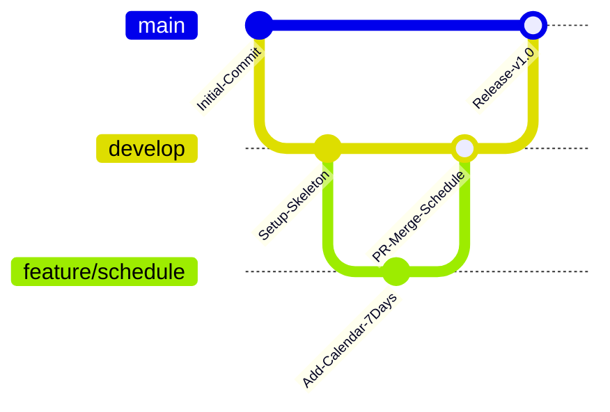

# EduCenter ERP – Hệ thống Quản trị Trung tâm Gia sư & Đào tạo

[](https://github.com/dangkhoauit184/WEB_GIA_S-/actions/workflows/pr-check.yml)
[](LICENSE)
[]()

> **Đồ án môn học:** Phát triển Ứng dụng Web  
> **Trường:** Đại học Công nghệ Thông tin – ĐHQG TP.HCM (UIT)  
> **Tác giả:** Nhóm phát triển dự án EduCenter ERP  

---

## 📖 1. Giới thiệu tổng quan dự án

**EduCenter ERP** là nền tảng quản trị tổng thể dành cho các trung tâm đào tạo và gia sư đa chi nhánh. Hệ thống giải quyết trọn vẹn bài toán vận hành từ tiếp nhận yêu cầu, ghép người dạy, xếp thời khóa biểu thông minh, quản lý buổi học thực tế (GPS check-in/out), đến đối soát công lương và học phí.

Hệ thống được thiết kế dựa trên **Đặc tả quy trình nghiệp vụ v2.0** với 9 quy trình cốt lõi và 20 quy tắc ràng buộc kinh doanh (`BR01` – `BR20`).

---

## 👥 2. Ma trận phân quyền 6 Vai trò (Role-Based Access Control)

| Vai trò | Người dùng Demo | Tài khoản / Mật khẩu | Phạm vi trách nhiệm chính |
| :--- | :--- | :--- | :--- |
| **Quản trị viên (Admin)** | Trần Quang Huy | `admin` / `123456` | Quản trị tài khoản, phân quyền 9 phân hệ (RBAC), cấu hình danh mục, kiểm toán hệ thống, **phê duyệt mở khóa bảng công (BR04/BR12)**. |
| **Giáo vụ (Staff)** | Lê Thị Mai | `giaovu` / `123456` | Tiếp nhận tuyển sinh, ghép lớp (Wizard 4 bước), xếp thời khóa biểu 7 cột chống trùng (BR01), duyệt đơn nghỉ (BR08), xếp lịch bù (BR09), chốt sổ thù lao tháng (`sp_chot_cong`, BR11). |
| **Giáo viên (Teacher)** | Nguyễn Minh Anh | `giaovien` / `123456` | Xem lịch dạy cá nhân, Check-in/out GPS, sổ học vụ (điểm danh 4 trạng thái, chấm bài tập giấy BR10), làm đơn từ (nghỉ dạy, đổi lịch, điều chỉnh công). |
| **Gia sư 1:1 (Tutor)** | Trần Quốc Bảo | `giasu` / `123456` | Quản lý ca học kèm tại nhà / Online, sổ bài học, theo dõi kết quả từng buổi của học viên kèm. |
| **Trợ giảng (TA)** | Phạm Gia Huy | `trogiang` / `123456` | Xem ca hỗ trợ, Check-in, hỗ trợ điểm danh học viên (bị khóa quyền chỉnh giáo án & chấm điểm), gửi báo bận. |
| **Phụ huynh (Parent)** | Nguyễn Thị Hoa | `phuhuynh` / `123456` | Theo dõi quá trình học của con, xem thời khóa biểu, tải đề bài PDF, theo dõi học phí và **làm đơn xin nghỉ học phép (`parent-leave`)**. |

---

## 📂 3. Cấu trúc thư mục dự án (Project Architecture)

```text
WEB_GIA_SU/
├── .github/
│   ├── PULL_REQUEST_TEMPLATE.md   # Mẫu Pull Request chuẩn khi gửi code lên nhánh chính
│   └── workflows/
│       └── pr-check.yml           # CI/CD Action tự động kiểm tra cú pháp khi mở PR
├── frontend/                      # Tầng giao diện người dùng (Client-side)
│   ├── assets/
│   │   ├── css/                   # Stylesheets dùng chung, CSS biến màu, theme
│   │   ├── js/                    # Logic nghiệp vụ, Router, Service, Validation
│   │   └── images/                # Tài nguyên hình ảnh, biểu tượng
│   ├── index.html                 # Ứng dụng EduCenter ERP hoàn chỉnh (SPA)
│   ├── mau1.html                  # Giao diện gốc mẫu 1 (Admin & Sidebar)
│   └── mau2.html                  # Giao diện gốc mẫu 2 (Thời khóa biểu tuần)
├── backend/                       # Khung sườn máy chủ API (RESTful Services)
│   ├── src/
│   │   ├── config/                # Cấu hình Database & JWT Secret
│   │   ├── controllers/           # Điều khiển nghiệp vụ (Schedule, Leave, Payroll)
│   │   ├── middleware/            # Kiểm tra phân quyền RBAC & Auth Guard
│   │   ├── models/                # Schema mô hình dữ liệu
│   │   └── routes/                # Định tuyến các API endpoints
│   ├── server.js                  # Entry point của máy chủ Node.js/Express
│   └── package.json
├── database/                      # Cơ sở dữ liệu quan hệ (RDBMS)
│   ├── trung_tam_gia_su_35_tables.sql  # DDL khởi tạo 35 bảng chuẩn CSDL
│   └── procedures.sql             # Stored Procedures (sp_sinh_buoi_hoc, sp_chot_cong)
├── docs/                          # Tài liệu thiết kế & đặc tả nghiệp vụ
│   ├── quy_trinh_nghiep_vu_v2.docx
│   └── architecture.md            # Thiết kế kiến trúc, flow chart, 20 Business Rules
├── .gitignore                     # Cấu hình bỏ qua file nhạy cảm và node_modules
├── index.html                     # Bản chạy trực tiếp ở thư mục gốc
└── README.md                      # Tài liệu tổng quan dự án
```

---

## ⚡ 4. Quy trình Git & Nguyên tắc Merge (Branch Protection Policy)

Hệ thống tuân thủ mô hình **Git Flow chuẩn doanh nghiệp**:



### 🔒 Quy tắc bảo vệ nhánh chính (`main`):
1. **Không được phép commit trực tiếp** (`git push origin main` bị chặn).
2. **Mọi thay đổi phải tạo branch riêng** (ví dụ: `feature/ten-chuc-nang` hoặc `fix/ten-loi`).
3. **Mở Pull Request (PR)** từ branch làm việc vào `develop` hoặc `main`.
4. **Điền đầy đủ thông tin** theo mẫu `.github/PULL_REQUEST_TEMPLATE.md`.
5. GitHub Action `pr-check.yml` phải chạy thành công (Passed) trước khi Reviewer chấp thuận gộp code.

---

## 🚀 5. Hướng dẫn chạy thử dự án

### Cách 1: Chạy trực tiếp Frontend (Khuyến nghị để chấm thi nhanh)
1. Mở file [index.html](index.html) bằng bất kỳ trình duyệt nào (Chrome, Edge, Firefox).
2. Tại màn hình Đăng nhập, bấm nút **"⚡ Đăng nhập nhanh 1-chạm"** để trải nghiệm từng vai trò.
3. Thử nghiệm các tính năng:
   - **Xếp lịch & sinh chuỗi buổi:** `/staff/staff-schedule`
   - **Làm đơn từ 5 loại:** `/teacher/teach-requests`
   - **Phụ huynh xin nghỉ:** `/parent/parent-leave`
   - **Chốt công & khóa sổ:** `/staff/staff-payroll` (BR11, BR12)

### Cách 2: Khởi động Mock Backend Server
```bash
cd backend
npm install
npm run dev
# Server lắng nghe tại http://localhost:5000
```

